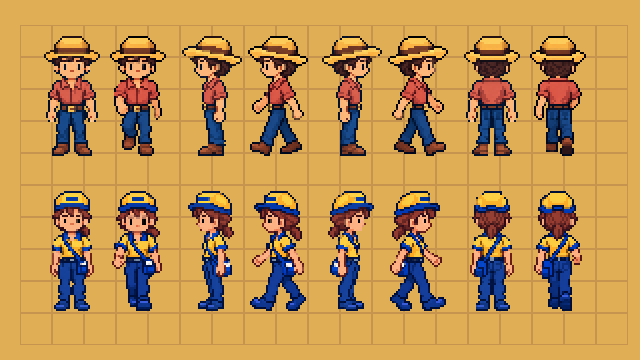

# Revisão visual e de usabilidade — em andamento

## Evidências e escopo

A base anterior à revisão é o commit `c68d00ff6505401dff5551edf9b23da5755944fc`. A revisão utiliza os dois DOCX, os 24 PNGs de `Arquivos-para-o-jogo.zip` e as sete capturas da versão anterior enviadas na conversa. Os PNGs foram inspecionados pelo agente de direção de arte; correspondência e contratos estão em `ASSET_MAPPING.md`, `VISUAL_REVIEW.md` e `UI_CONTRACT.md`. Nenhum dos três conceitos de cenário deve ser usado como fundo que duplique objetos interativos.

O usuário autorizou explicitamente usar o repositório Boa Sorte para a produção, após confirmar que North Asset Forge 2D não estava disponível. As responsabilidades continuam separadas: assets e suas fontes; código/testes de integração; direção de arte/contratos. Não foram criados agentes adicionais.

## Problemas e correções

| Evidência anterior | Causa identificada | Alteração |
| --- | --- | --- |
| Título e pausa só com instruções de teclas | UI desenhada como texto em `_draw`, sem controles clicáveis | `scripts/ui.gd` usa botões, foco e containers Godot |
| Aviso atravessa personagem e alvo | Faixa central de largura fixa | Área temporária no topo; mensagem sai após temporizador |
| Barras e rótulos desalinhados | Posições independentes no desenho imediato | Linhas de vida/estamina com valores atuais/máximos ligados ao estado |
| IDs e inglês sobre móveis | Labels de implementação no desenho do cenário | Remoção de nomes técnicos permanentes; nomes em português nos painéis |
| Carta/textos não se adaptam aos painéis | Quebra manual e altura fixa | Rolagem e containers; testes geométricos nas escalas 100/125/150% |
| Clique em painel interfere no mundo | Eventos de UI e mundo sem separação de despacho | Controls consomem mouse; gameplay em `_unhandled_input`; teste com eventos no viewport |
| Nova partida pode substituir save | Ação escolhia espaço 1 diretamente | Primeiro espaço vazio; confirmação explícita quando todos ocupados |
| Chegada de Lia não troca de painel automaticamente | Chave de atualização omitindo estados de chegada/saída | Estados de Lia passam a invalidar a interface |
| Caminhada ausente e Lia olhando para o lado errado | Animação dependia do temporizador da ferramenta e orientação de Lia era fixa | Caminhada usa deslocamento efetivo; direção acompanha chegada e saída |
| Editor dependia do mouse | Preview atualizado continuamente pela posição do cursor | Teclado desloca preview e confirma; movimento do mouse retoma controle |
| Personagens geométricos | Arte provisória procedural | Atores derivados das vistas originais, com fonte/hash/pivô registrados; revisão estática apenas |

## Validação e limites

O teste lógico `tests/qa.gd` passou nesta revisão: abertura, entrega única, ferramentas incorretas, estamina zero, alimentos, reparos, limpeza, cultivo, móveis, salvamento e manhã seguinte. Dormir continua sem recuperar estamina. O harness acelera a partida por reposicionamento e reposição controlada de estamina; não constitui uma sessão manual.

`ui_flow.gd`, `ui_input.gd` e `ui_layout.gd` verificam estados, despacho de eventos e limites geométricos. Aprovação desses testes não comprova legibilidade, qualidade visual, animação convincente nem funcionamento em Windows.

A execução gráfica do Godot na nuvem foi recusada pelo controle de permissões. A tela virtual Xorg iniciou, mas o jogo não recebeu autorização para executar nela. Não houve captura nova do framebuffer, comparação visual antes/depois em execução nem revisão completa em 720p/1080p/redimensionamento. As capturas do antes foram fornecidas pelo usuário; não foram produzidas nesta revisão. Nenhuma composição estática será apresentada como screenshot do jogo.

A amostra deve ser revisada em execução antes de expandir o acabamento para todo o catálogo. A fidelidade dos cenários e a animação completa continuam em produção. Esta revisão não está concluída enquanto esse aceite permanecer pendente.

## Prévia estática dos personagens

Essa prancha mostra sprites isolados em escala ampliada. Não comprova animação, leitura no cenário ou qualidade da interface em execução.

## Verificação final da amostra

Godot 4.6.3: importação, 186 verificações de gameplay, 28 de fluxo de UI, 11 de despacho de eventos, limites geométricos em 100/125/150% e carregamento das cenas passaram sem `SCRIPT ERROR` ou `ERROR:`. O validador confirmou 135 PNGs e 10 WAVs. Essas verificações são headless e não aprovam apresentação visual.

A amostra inclui atores em quatro direções, casa/janela independentes, seis ícones de ferramentas, quatro tiles internos e os quatro móveis preservados com orientações para o editor. Gestos usam corpo novo com ferramenta sobreposta enquanto as animações completas não são entregues. Vegetação, ruínas, móveis condenados e outros itens ainda incluem a arte provisória anterior. As rachaduras internas repetem um mesmo padrão e precisam de variação. Caminhada tem dois quadros por direção; rotações de móveis usam normalização provisória.

A branch `visual-ui-sample` mantém a revisão separada da versão anterior. O pacote `dist/BoaSorte-Amostra-Visual-Windows11.zip` inclui executável com dados incorporados e `Gerar-capturas.bat`. Não houve execução do binário em Windows. O capturador monta estados artificiais e usa o espaço 9001, recusando arquivos preexistentes; ele não representa uma partida manual completa. O ZIP anterior permanece preservado.

Exportação Windows concluída sem erros. O pacote incorporado carregou FARM01/HOME01 e todos os assets no motor Linux em modo headless; isso não executa o binário Windows. ZIP: 36.517.208 bytes, SHA-256 `c3973063cb189e75d977893e0da186b866347cf7928808a807b1e90dd096c321`.
